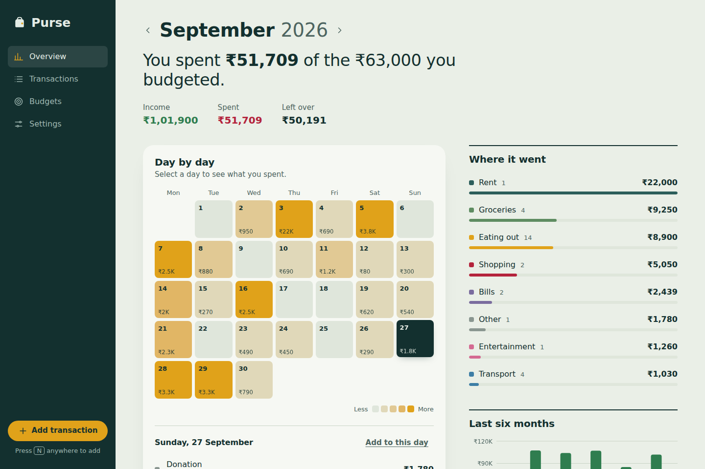
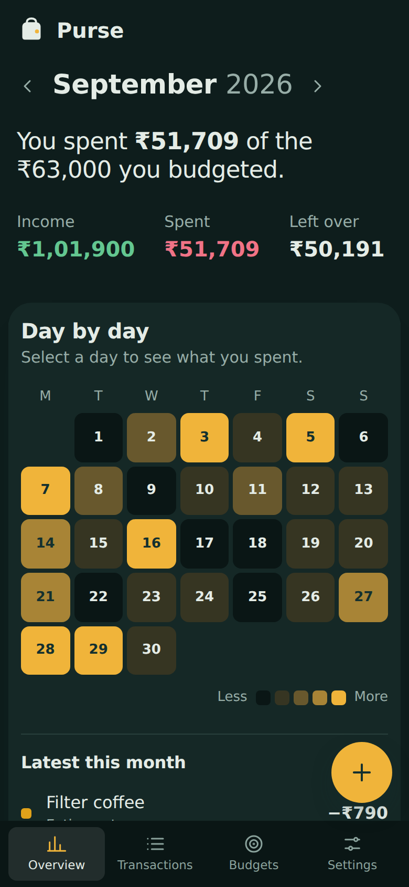
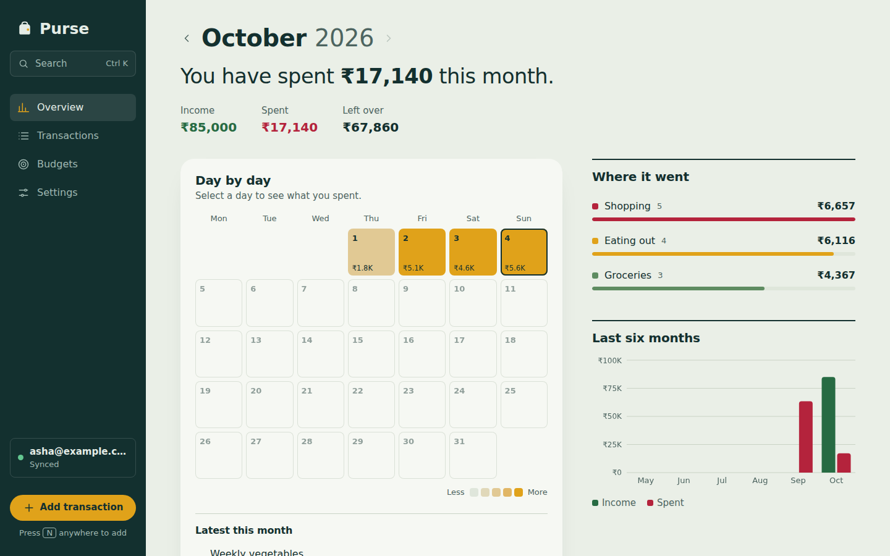
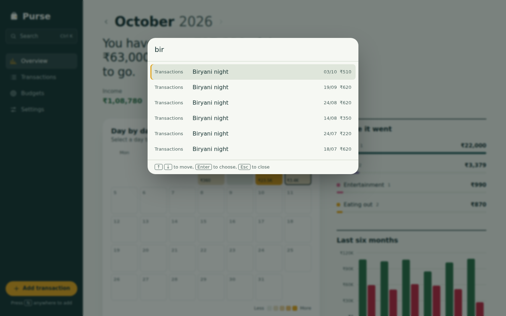

# Purse

An offline-first expense tracker built with React, TypeScript, and Supabase. Purse shows where your money goes day by day: a spending calendar, category breakdowns, monthly budgets, and a six-month trend. It works entirely in the browser, and signing in syncs your data across devices.

**Live demo:** https://Sairam0207.github.io/purse/

[](https://github.com/Sairam0207/purse/actions/workflows/ci.yml)



## Highlights

- **Offline-first cloud sync with Supabase**: magic-link sign-in, a persisted outbox with batched, idempotent, retried writes, incremental keyset-paginated pulls, and realtime updates across devices. Data is protected by Postgres Row Level Security, which is covered by 19 pgTAP tests in CI. See [`docs/BACKEND.md`](docs/BACKEND.md).

- **Reusable component library** (`src/ui`) with a live, documented gallery at [`/#/components`](https://Sairam0207.github.io/purse/#/components). Every component handles its own accessibility wiring.
- **Automated browser testing**: 55 Playwright tests run against production builds on desktop and mobile, including axe-core WCAG 2.1 AA checks on every page in both themes, and a cloud suite that drives the real Supabase SDK against a mocked API.
- **Built to scale**: a custom virtualized list keeps the DOM under 80 nodes with 10,000+ transactions, using prefix sums and binary search. Bundle size budgets are enforced in CI.
- **Engineering decisions documented** in [`docs/DECISIONS.md`](docs/DECISIONS.md), with the alternatives considered and the trade-offs accepted for each library and pattern.
- **Operational hardening**: error boundaries with chunk-failure recovery, validation of persisted data, global error capture, and Core Web Vitals monitoring.

## Features



- **Spending calendar.** Each day is shaded by how much you spent. Select a day to see its transactions. Fully keyboard navigable.
- **Command palette.** Press <kbd>Ctrl</kbd>+<kbd>K</kbd> (or <kbd>⌘</kbd>+<kbd>K</kbd>) to jump to any page, switch theme, or fuzzy-search transactions.
- **Transactions.** Search, filter, and sort. Filters live in the URL, so any view can be bookmarked, shared, or survive a refresh.
- **Add and edit** in an accessible dialog with inline validation. Press <kbd>N</kbd> anywhere to add. Deletes can be undone.
- **Budgets** per category with progress bars and a "safe to spend per day" figure.
- **Sign in and sync** with a one-time email link. Edits made offline are kept and sent when you're back online, and changes from your other devices appear live.
- **CSV import and export** with row-level error reporting.
- **Light, dark, and system themes**, with no flash of the wrong theme on load.
- **Responsive** from 320px phones (bottom tab bar, floating add button) to wide desktops.

<br clear="right" />





## Tech stack

| Area | Choice |
| --- | --- |
| Framework | React 19, TypeScript (strict) |
| Build | Vite |
| Routing | React Router (hash router for static hosting) |
| State | Zustand with `persist` middleware |
| Backend | Supabase: Postgres with Row Level Security, Auth (magic link, PKCE), Realtime |
| Charts | Recharts, lazy loaded with its route |
| Unit and component tests | Vitest, React Testing Library |
| Browser tests | Playwright, @axe-core/playwright |
| Database tests | pgTAP |
| Monitoring | web-vitals, error boundary and global handlers |
| CI/CD | GitHub Actions: lint, typecheck, coverage, bundle budget, E2E, database tests, deploy to GitHub Pages |

## Testing

| Layer | Count | What it covers |
| --- | --- | --- |
| Unit and component | 95 tests | Money parsing, stats, CSV, fuzzy search, virtualization, storage validation, stores, the UI library, and the sync engine against an in-memory fake server (outbox, retries, conflicts, pagination, account switching) |
| End to end | 51 tests | Add, edit, delete and undo; filters in the URL; persistence; keyboard navigation; command palette; budgets; CSV round trip; 10k-row performance |
| Cloud E2E | 4 tests | The cloud build and real supabase-js against a mocked API: PKCE sign-in, pulling account data, push payloads, offline changes surviving a reload |
| Accessibility | 11 pages and states × 2 themes | axe-core WCAG 2.1 AA on every route in light and dark mode, plus the open dialog |
| Database | 19 pgTAP tests | Users can't read or change each other's data, constraints hold, upserts are idempotent, timestamps are server-owned |

Coverage is enforced at 90% for `src/lib`, `src/ui`, `src/store`, and `src/sync` (currently about 96%). E2E tests pin the clock with `page.clock` so date-dependent screens are deterministic.

The E2E suite has already earned its keep. It caught that the native `<dialog>` moves focus to the Close button and not to the first input. It also caught a chart that exposed focusable elements inside `aria-hidden`, and two color-contrast failures that unit tests in jsdom could never see.

## Engineering notes

**Money is stored as integers.** Amounts are kept in paise or cents and parsed from strings without floats, so `0.29` is exactly `29`, never `28.999999999999996`.

**Business logic lives outside components.** Totals, filtering, CSV, fuzzy matching, heatmap scaling, and virtualization are pure functions in `src/lib`, which keeps components thin and logic easy to test.

**Virtualization.** Row offsets are precomputed as prefix sums in O(n). Each scroll frame binary searches them in O(log n) to find the visible range, so only those rows render. Screen readers still hear "item 6,214 of 10,000" through `aria-posinset` and `aria-setsize`. See `src/lib/virtual.ts`.

**Accessibility.** Native `<dialog>` for modals, the WAI-ARIA combobox pattern for the command palette, roving `tabindex` on the calendar, `aria-describedby` errors with focus moved to the first invalid field, a data-table fallback for the chart, skip link, route-change focus management, and `prefers-reduced-motion` support.

**Performance.** Each route is a separate chunk. Search uses `useDeferredValue` to keep typing responsive on large lists. The initial download is about 114 kB gzip against a 140 kB budget that CI enforces.

**Sync.** Local writes apply instantly and go into a persisted outbox. Ids are generated on the device, so writes are idempotent upserts that are safe to retry. Pulls use an `(updated_at, id)` keyset cursor with server-assigned timestamps. A row the server permanently rejects is dropped and reported instead of blocking the queue. All backend access goes through one `RemoteApi` interface, which is how the engine is unit tested and how the backend could be swapped.

**Resilience.** Saved data is validated on load, and malformed records are dropped instead of crashing the app. A failed chunk download after a deploy shows a "new version available" screen with a reload button.

## Getting started

Requires Node.js 20 or newer. The app runs in local-only mode by default. To enable sign-in and sync, follow [`docs/BACKEND.md`](docs/BACKEND.md) and copy `.env.example` to `.env`.

```bash
npm install
npm run dev               # http://localhost:5173

npm test                  # unit and component tests
npm run test:coverage     # with coverage thresholds
npx playwright install chromium   # once
npm run test:e2e          # browser tests against the production build
npm run test:e2e:ui       # Playwright's interactive UI mode

npm run test:db           # pgTAP database tests (needs DATABASE_URL, see docs/BACKEND.md)
npm run check             # lint + typecheck + unit tests
npm run build && npm run size     # production build + bundle budget
```

## Project structure

```
src/
  ui/           Component library: Button, IconButton, Field, Select, SegmentedControl,
                Dialog, confirm(), ProgressBar, Skeleton, EmptyState
  components/   App components: layout, command palette, calendar, virtual list, charts
  hooks/        useWindowVirtualizer, useMoney, useTheme, useToday, useDocumentTitle
  lib/          Pure logic: format, stats, filter, csv, fuzzy, virtual, validate, monitoring
  pages/        Overview, Transactions, Budgets, Settings, Components gallery
  store/        Zustand stores: ledger (persisted, validated), settings, ui, toast
  sync/         Offline-first sync: engine, outbox, Supabase adapter, auth, in-memory fake
supabase/
  migrations/   Schema, constraints, indexes, Row Level Security, realtime
  tests/        pgTAP tests and a Supabase auth shim for plain Postgres
e2e/            Playwright specs: journeys, accessibility, performance, cloud sync
docs/           Architecture decisions and screenshots
scripts/        Bundle size budget check
```

## Deploying

Pushing to `main` runs `.github/workflows/deploy.yml`, which tests, builds, checks the budget, and publishes to GitHub Pages. In the repository, set **Settings → Pages → Source** to **GitHub Actions** once. To enable sync on the deployed site, add `SUPABASE_URL` and `SUPABASE_ANON_KEY` as repository variables (see [`docs/BACKEND.md`](docs/BACKEND.md)).

## Contributing

See [CONTRIBUTING.md](CONTRIBUTING.md). Pull requests use a template that covers testing, accessibility, and bundle impact.

## Roadmap

- Recurring transactions (a Supabase scheduled function)
- Shared household budgets with roles
- Custom categories
- Installable PWA with offline caching
- Visual regression tests with Playwright screenshots

## License

MIT
